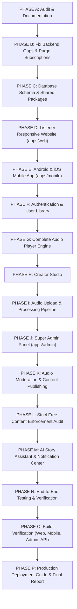

# Kathaisolli (கதைசொல்லி) — Implementation Plan

Date: 2026-10-30  
Target Architecture: Monorepo (`apps/api`, `apps/web`, `apps/mobile`, `apps/admin`, `packages/*`)  
Business Model: 100% Free (No payments, no subscriptions, no paywalls)

---

## 1. Master Phasing Overview

---

## 2. Phase-by-Phase Roadmap

### PHASE A — Repository Audit & Baseline Verification
- Deliverables:
  - `PROJECT_AUDIT.md` (completed)
  - `IMPLEMENTATION_PLAN.md` (this file)
  - `IMPLEMENTATION_STATUS.md`
  - `API_DOCUMENTATION.md`
  - `TEST_REPORT.md`
- Verification: Baseline test suite passing (9/9 suites, 26/26 tests).

### PHASE B — Backend Gap Remediation & Subscription Purge
- Tasks:
  - Remove all subscription entitlement requirements from `playback.service.ts` so all published episodes stream freely.
  - Safely deprecate `premiumFlag` checks across catalog controllers, query DTOs, and services.
  - Implement missing API endpoints:
    - User Library: Favorites, Listening History, and Playback Progress synchronization.
    - Playlists: Create, read, update, delete user custom playlists.
    - User Profile: Avatar update, profile details, password reset, account deletion.
    - Creator Application: Submission and approval workflows.
    - Admin Metrics & Content Moderation: KPIs, bulk moderation actions, user suspension.
    - In-App Notifications: Retrieval, mark-as-read, preferences.
    - AI Story Assistant: Ideation, titles, descriptions, Tamil grammar/translations.
- Verification: Unit tests updated and verified with `pnpm test:api`.

### PHASE C — Database Models & Shared Monorepo Packages
- Tasks:
  - Update `apps/api/prisma/schema.prisma` with safe additions: `Favorite`, `ListeningHistory`, `PlaybackProgress`, `Playlist`, `PlaylistItem`, `Notification`, `CreatorApplication`, `AuditLog`.
  - Ensure zero destructive changes to existing tables or columns.
  - Generate updated Prisma Client (`pnpm db:generate`).
  - Create monorepo packages:
    - `packages/shared-types`: Unified TypeScript domain interfaces.
    - `packages/design-tokens`: Colors, typography, spacing, themes.
    - `packages/validation`: Client/server Zod schemas.
    - `packages/shared-utils`: Audio formatters, Tamil date utilities, slug generators.
    - `packages/api-client`: Universal HTTP client with token handling.
- Verification: Monorepo workspace package resolution and clean builds.

### PHASE D — Listener Responsive Website (`apps/web`)
- Tasks:
  - Bootstrap Vite + React + TypeScript + Tailwind CSS in `apps/web`.
  - Brand identity implementation: Forest Green (`#064E3B`), Mint Green (`#A7F3D0`), Deep Green (`#022C22`), dark/light modes.
  - Build all 25 core pages:
    1. Landing Page
    2. Home (Hero, Trending, Tamil stories, Categories, Creators, Continue Listening)
    3. Explore
    4. Search (real-time filtering by category, language, text)
    5. Categories
    6. Languages
    7. Story Details
    8. Series Details
    9. Season Details
    10. Episode Details
    11. Full Audio Player modal / page
    12. Login
    13. Register
    14. User Profile
    15. My Library
    16. Favorites
    17. Listening History
    18. Continue Listening
    19. Offline Downloads manager (PWA / IndexedDB)
    20. Playlists
    21. Notifications
    22. Settings
    23. Help and Support
    24. Privacy Policy
    25. Terms and Conditions
- Verification: Build `pnpm --filter @kathaisolli/web build` passes cleanly.

### PHASE E — Android and iOS Mobile Application (`apps/mobile`)
- Tasks:
  - Set up React Native Expo project structure in `apps/mobile` with Expo Router.
  - 24 mobile screens matching exact spec:
    - Splash, Onboarding, Language Selection, Login, Register, Home, Explore, Search, Categories, Story Details, Series Details, Episode List, Full Audio Player, Mini Player, Queue, Library, Favorites, History, Downloads, Playlists, Profile, Notifications, Settings, Help & Support.
  - Responsive layout for Android & iOS phones and tablets.
  - Mobile architecture: Audio playback lifecycle, background audio, lockscreen integration, and offline persistence.
- Verification: TypeScript type check passes cleanly.

### PHASE F — User Authentication & Personal Library
- Tasks:
  - Universal login, registration, password recovery, session handling.
  - Synchronized listening history and playback progress across Web and Mobile.
  - Favorites management and custom user playlists.
  - Guest mode enabling public listening to any published story without forced login.
- Verification: API client integration tests verifying library synchronization.

### PHASE G — Audio Player Engine (Web & Mobile)
- Tasks:
  - Web Audio Player component and Mobile Audio Manager.
  - Features: Play, Pause, Resume, Seek, ±10s skips, Next/Prev episode, 0.5x–2.0x speed, sleep timer, queue, auto-play next, persistent mini-player, full-screen player.
  - Progress persistence: Debounced reporting to `PUT /api/v1/library/progress`.
  - Resilience: Automatic reconnection on network interruption.
- Verification: Audio controls and state management verified in web/mobile environments.

### PHASE H — Creator Studio
- Tasks:
  - Creator portal for verified creators.
  - Profile setup, bio, social links.
  - Story, Series, Season, and Episode authoring.
  - Submission for moderation with validation checks.
  - Creator listening analytics: Plays, listening hours, completion rates.
  - Strict scope isolation: Creators can only read and mutate their own content.
- Verification: Creator workflow tested with unit and role tests.

### PHASE I — Audio Upload & Processing Pipeline
- Tasks:
  - Drag-and-drop file picker with multi-file support.
  - Audio format validation (MP3, WAV, M4A, AAC, FLAC) and size limit checks.
  - Direct private upload to MinIO/S3 via presigned POST form.
  - Processing lifecycle: `CREATED` → `UPLOADING` → `UPLOADED` → `QUEUED` → `PROCESSING` → `PROCESSED` → `PENDING_REVIEW`.
  - BullMQ job queue with retry strategies and FFprobe metadata extraction.
- Verification: Upload lifecycle service tests verifying validation and queueing.

### PHASE J — Super Admin Panel (`apps/admin`)
- Tasks:
  - Bootstrap modern React + Vite + Tailwind CSS admin dashboard in `apps/admin`.
  - Dashboard analytics overview: Active users, creators, stories, audio hours, system health.
  - 29 sidebar management sections (Users, Creators, Stories, Series, Seasons, Episodes, Audio Uploads, Processing, Moderation, Categories, Languages, Authors, Narrators, Banners, Featured, Scheduling, Free Content Management, Comments, Complaints, Notifications, Analytics, Reports, Audit Logs, Settings).
- Verification: Admin build `pnpm --filter @kathaisolli/admin build` passes cleanly.

### PHASE K — Audio Moderation & Content Publishing
- Tasks:
  - Admin audio preview and metadata inspector.
  - Approval, Rejection (with mandatory moderation notes), and Correction requests.
  - Scheduled and immediate publication triggers.
  - Audit logging for all administrative actions.
- Verification: Moderation transition tests passing with role verification.

### PHASE L — Free Content Enforcement Audit
- Tasks:
  - Systematic code scan ensuring zero references to Razorpay, Stripe, payment gates, subscription plans, or paid episodes.
  - Verification that every public episode stream authorizes freely without paywalls.
- Verification: Automated grep audit across all workspaces.

### PHASE M — AI Story Assistant & Notification Center
- Tasks:
  - AI Assistant service: Story idea generator, title and summary creator, Tamil grammar and translation helper.
  - Notification service: Push and in-app event dispatching.
- Verification: Unit tests for AI Assistant endpoints with mock providers.

### PHASE N — End-to-End Testing & Verification
- Tasks:
  - Full end-to-end integration scenario execution across auth, catalog, playback, upload, moderation, and library.
  - Generate comprehensive `TEST_REPORT.md`.
- Verification: Full test suite passing across all packages.

### PHASE O — Monorepo Build Verification
- Tasks:
  - Build verification of all projects:
    - `apps/api`
    - `apps/web`
    - `apps/admin`
    - `apps/mobile`
    - `packages/*`
- Verification: Zero build failures across the entire monorepo.

### PHASE P — Production Deployment Guide & Final Report
- Tasks:
  - Update `README.md` and `docs/implementation-status.md`.
  - Provide complete deployment instructions for Docker, Web, Android, iOS, and Admin.
  - Executive delivery summary for the user.
